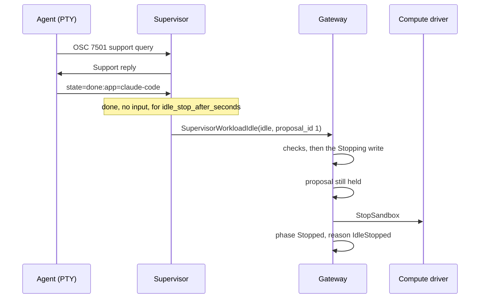

---
authors:
  - "@mrunalp"
state: draft
links:
  - https://github.com/ai-openshell/openshell/issues/5852
  - https://github.com/ai-openshell/openshell/pull/5856
---

# RFC 0025 - Stop Idle Agent Sandboxes

## Summary

The supervisor reads the program status that coding agents already write to
their terminal with OSC 7501, the Program Status Protocol. When an agent has
been waiting on the user for longer than a configured timeout, the supervisor
proposes an idle stop and the gateway stops the sandbox.
A later `openshell sandbox connect` starts the sandbox again before connecting.

Phase 1 uses the existing stop and start lifecycle. Filesystem state survives,
and the agent resumes its conversation from disk. Phase 2 reuses the same
activity signal to drive the existing `SuspendSandbox` and `ResumeSandbox`
contracts once a backend implements memory checkpoints.

## Motivation

Agent sandboxes spend most of their life waiting. A coding agent finishes a
turn, reports its result, and then sits at a prompt until a person comes back,
often hours later or never. The sandbox keeps its CPU and memory reservations
and its node or VM the whole time. Operators clean up by hand or not at all.

OpenShell cannot tell an idle agent from a busy one today. The only activity
signal is the network connection summary the supervisor sends for telemetry.
An agent waiting on a person and a long build that makes no connections look
the same from outside. Screen scraping, such as matching a spinner in the
window title, is fragile and differs for every agent.

OSC 7501 ([spec](https://www.superlogical.com/rex/docs/build/program-status),
[announcement](https://mitchellh.com/writing/program-status-osc7501)) gives
programs a standard way to declare `idle`, `working`, `done`, `blocked`, or
`error` on their own terminal. Claude Code (from v2.1.295) and Codex (0.170.0
verified) report it natively. The workload PTY already passes through the supervisor, so OpenShell
can read these reports without agent-specific integrations or new workload
dependencies.

The lifecycle side is partly built. `StopSandbox`, `StartSandbox`,
`SuspendSandbox`, and `ResumeSandbox` exist in the public and driver APIs, but
nothing stops a sandbox on its own and no driver implements suspend.

## Non-goals

- Memory checkpoints. Phase 1 stops compute and loses process memory. CRIU or
  VM snapshots are phase 2 and follow the suspend contract, not this RFC.
- Detecting idleness for programs that do not report OSC 7501. A sandbox with
  no reports is never stopped automatically. A waiting report describes only
  its own program. Phase 1 does not see other work in the same sandbox:
  - a non-reporting terminal;
  - a non-PTY `sandbox exec`;
  - a command run in a shell after its agent exited.

  Users can rely on idle stop only when the reporting agent is the sandbox's
  only long-running work, and the docs say so.
- Showing program status to clients. Phase 1 does not expose the reported
  state through `GetSandbox`, `WatchSandbox`, or `ListSandboxes`; Open
  questions records how a later change could.
- Waking on inbound service traffic. Only an explicit connect or start wakes a
  sandbox in phase 1.
- Interpreting the free-text `msg` and `title` fields. They are validated and
  then dropped, never stored or logged.
- Agent-specific resume logic. OpenShell restarts the canonical command; the
  agent's own `--continue` or `resume` flags restore its conversation.

## Proposal

### Observe program status in the supervisor

The supervisor scans PTY output for OSC 7501 in two places:

- the canonical process reader (`openshell-supervisor-process/src/main_session.rs`)
- the SSH exec loop for PTY sessions (`ssh.rs`)

Both run on plaintext before output reaches any client, and the canonical
reader runs whether or not a client is attached.

The scanner keeps the per-terminal records the protocol defines:

- record ids and hierarchy;
- `clear` semantics;
- drop `working` and `blocked` records on process exit or OSC 133 `A`;
- the 256-record cap;
- the 4096-byte sequence limit.

Report bytes pass through unchanged, so a supporting client terminal still
shows status.

The supervisor answers the support query (`OSC 7501 ; ?`) itself by writing
the reply to the program's input, and strips the query from forwarded output.
The reply is the full form, `OSC 7501 ; ? : states=... : kinds=... ST`. A
program that probes with terminal echo on reads its own echo, and a reply
identical to the query would be answered again without end.

Answering the probe is required, not an optimization. A prototype run against
Claude Code 2.1.327 showed:

- It probes at startup, followed by a DA1 (`CSI c`) query.
- It reports only if the OSC 7501 reply arrives before the DA1 reply. That
  follows the spec's detection rule.
- The supervisor's reply reaches the program before any client terminal's.
- Stripping the query keeps a supporting client terminal from answering a
  second time into the program's input.

The supervisor keeps the result as a sandbox-wide summary: the most active
state across terminals (working, then blocked, error, done, idle), plus its
`kind` and `app`. It also tracks when that state began and when any client
last wrote to a workload terminal.

Observed behavior through the supervisor's scanner:

| Event | Claude Code 2.1.327 | Codex 0.170.0 |
|-------|---------------------|---------------|
| Support query | Sent at startup | Never sent |
| Startup | `idle` | `idle` |
| Prompt submitted | `working` | `working` |
| Turn finished | `done` | `done` |
| Folder trust or approval prompt | `blocked:kind=permission` | `blocked:kind=permission` |
| Approval denied or interrupted | `clear` | `working`, then `idle` |
| Exit | `clear` | `clear` |

Neither agent returns to `idle` after a finished turn, so the policy treats
`done` as waiting on the user. Codex reports without querying first, so the
scanner keeps records for every terminal whether or not its program asked.

### Propose idle stops from the supervisor

The supervisor owns the idle clock. It already tracks when the sandbox-wide
state began and when client input last arrived, and it receives runtime
settings through its configuration poller. It applies the sandbox's effective
`idle_stop_after_seconds` itself and tells the gateway only when to stop:

```proto
message SupervisorMessage {
  oneof payload {
    // ... existing variants 1-6 ...
    SupervisorWorkloadIdle workload_idle = 7;
  }
}

message SupervisorWorkloadIdle {
  uint64 proposal_id = 1;                 // increases per proposal on a session
  bool idle = 2;                          // true: proposal; false: retraction
  WorkloadProgramState state = 3;         // for logs
  WorkloadBlockedKind blocked_kind = 4;
  string app = 5;                         // OSC 7501 app grammar
  google.protobuf.Duration idle_for = 6;  // wait when sent
}
```

`SupervisorHello.supports_idle_proposals` (field 10) advertises it. The gateway
idle-stops only sandboxes whose current supervisor sets it, so a supervisor
too old to propose is never stopped.

On each gateway session, an idle reporter checks every second and on every
summary change. Once some program reports, none is `working`, and the later of
the state change and the latest client input is older than the timeout, it
sends a proposal. While the wait continues it repeats the proposal with a new
id every minute, in case the gateway declined it under a longer gateway-side
setting. Input or a state change that ends the wait sends a retraction with
the last proposal's id. Each session starts its ids at 1, so a reconnect, or a
session moved to another replica, proposes again. The reporter runs on its
own task and never blocks the session's receive loop.

The supervisor applies reports, OSC 133 `A` prompts, and full resets (RIS) in
output order, however reads split them. A prompt ends only the reports before
it, and a reset clears the terminal's records as the spec requires. The
scanner treats `ESC c` outside an OSC as a reset, including inside other
control strings; a terminal ends those strings at `ESC` and resets too. Every
transition restarts the state timer and advances a revision, including a
`working` → `done` turn within one read. The latest input time outlives the
terminal that received it.

Proposals write nothing to the store and add no public `Sandbox` fields, so
SDK users who build exhaustive `SandboxStatus` literals still compile, as the
`sandbox_status_compatibility` fixture requires.

### Stop idle sandboxes

The timeout is a new runtime setting, `idle_stop_after_seconds`, set with
`openshell settings set` at gateway or sandbox scope. As with every runtime
setting, gateway scope wins over sandbox scope. It can be changed on a running
sandbox and reaches the supervisor with its next configuration update. Unset,
zero, or negative disables idle stop, and values above 30 days are capped. No
new `SandboxSpec` field or gateway TOML key is needed.

The replica holding the supervisor session keeps that session's latest
proposal in memory. A proposal from a replaced session, or an older one from
the current session, is dropped, and a retraction removes the proposal it
names. A gateway that restarts stops nothing until the new session proposes,
so a workload that resumed work during an outage is not stopped on a stale
record. A proposal starts at most one idle stop per sandbox, through the
existing stop path with an idle cause.

Under the lifecycle lock, each `Stopping` write attempt requires:

- the same session's proposal still held;
- phase `Ready`, on the proposing main-process instance;
- the gateway's own effective timeout, reached by the proposal's wait, so a
  supervisor still on an older, shorter setting does not decide;
- a fresh shared owner record that names the session.

After the `Stopping` write and before the driver call, the stop checks the
proposal again. A retraction or session change received in between rolls the
sandbox back to its previous state and abandons the stop. If that rollback
loses a write race, the stop goes ahead like any other in-flight stop. No
report waits on a store write, so the session keeps reading messages
throughout.

The stop boundary is therefore:

- **Always counted:** input or a new turn that the supervisor sees, and whose
  retraction reaches the gateway, before the check that follows the `Stopping`
  write.
- **Can race the stop:** input in the last second before that check, which
  the reporter has not yet noticed, and anything after it while the driver
  call runs.

A takeover by another replica is bounded the same way. The new owner publishes
ownership before it updates the sandbox record, and the new session's
proposals start over, so the old session's proposal no longer holds once the
new session registers.

The idle request writes the internal annotation `internal.openshell.ai/idle-stop`
with the reason `IdleStopping`. The annotation survives gateway recovery and
driver snapshots that rewrite conditions. The Ready condition then settles as
`IdleStopped` instead of `Stopped`, so users and the CLI can tell an idle stop
from an explicit one. The gateway reapplies that reason when a driver snapshot
of the stopped runtime rewrites it. Any other lifecycle write removes the
annotation, including a rollback. An explicit `sandbox stop` rewrites an idle
stop as an ordinary stop, so `sandbox connect` no longer starts it. This holds
whether the idle stop has settled or is still waiting on the driver on another
replica. The gateway logs each idle stop with the sandbox, the program, and how
long it waited.



### Wake on connect

When the target is `Stopped` with reason `IdleStopped`,
`openshell sandbox connect` calls `StartSandbox`, waits for `Ready`, then
connects as usual, printing a one-line notice. When an idle stop is still in
flight (`Stopping` with reason `IdleStopping`, which the gateway keeps through
driver snapshots), connect first waits for the sandbox to leave `Stopping`:

- `Ready`, as after a rolled-back stop, connects directly;
- `Starting`, as when another client already restarted it, waits for `Ready`;
- `Stopped` with `IdleStopped` starts it. An explicitly stopped
sandbox keeps today's behavior and returns an error. The wake logic lives in the
CLI; the TUI and SDK do not wake sandboxes in phase 1.

Exec and SSH proxy paths keep their current errors in phase 1, so scripts do
not start sandboxes implicitly.

### Security and trust

The workload controls the signal:

- Falsely reporting `working` only keeps its own sandbox running, which it can
  already do by staying busy.
- Falsely reporting `idle` stops its own sandbox.
- Neither crosses a trust boundary.

A stray report, such as a program printing a log file that contains OSC 7501
bytes, can make a sandbox look idle. The input-age condition limits the damage
to sandboxes no one is typing into.

The supervisor writes only the fixed reply bytes to program input, never
report content. `msg` and `title` are validated per the spec, then discarded.

## Implementation plan

1. **Supervisor observation.** Add the OSC 7501 scanner, records, probe reply,
   and summary in `openshell-supervisor-process`. Wire them into the canonical
   reader and SSH PTY sessions, with unit tests for parsing, chunk splits,
   limits, and record semantics. A prototype harness has run Claude Code
   2.1.327 and Codex 0.170.0 through the scanner on a host PTY.
2. **Proposals.** Register the `idle_stop_after_seconds` setting, deliver it
   to the supervisor's idle reporter, and add `SupervisorWorkloadIdle`.
3. **Policy.** Add the gateway handler, the checks before and after the
   `Stopping` write, and the `IdleStopped` reason, and document them on the
   sandbox lifecycle page.
4. **Wake on connect.** Auto-start `IdleStopped` sandboxes in
   `openshell sandbox connect`.
5. **Validation.** Add the `idle_stop` conformance test, which runs a
   scripted OSC 7501 agent on every driver through two sequences.
   `IdleStopped`, then `sandbox connect`, starts it again.
   `IdleStopped`, then an explicit stop, then `sandbox connect`, leaves it
   stopped. Check Claude Code and Codex manually inside Docker
   and Kubernetes sandboxes, with provider credentials.
6. **Phase 2 (separate change).** Choose `suspend` instead of `stop` when the
   driver advertises `openshell.compute.suspend-resume`, and implement Podman
   checkpoint and restore behind that capability.

Idle stop is off by default, so existing users see no change until an operator
sets a gateway value or a user opts in per sandbox.

## Risks

- **Lost in-flight work.** A `blocked` agent loses the pending turn when
  stopped. The timeout applies to all waiting states in phase 1. If users find
  that too aggressive, a separate blocked timeout is an open question.
- **Agent coverage and drift.** Only agents that implement OSC 7501 benefit,
  and their reporting can change between releases, as Claude Code's
  probe-before-report rule shows. Unreported sandboxes are never stopped, so
  drift fails safe.
- **Multiplexers.** An agent inside tmux in the sandbox probes tmux, not the
  supervisor's PTY, and tmux does not forward the reports. Those sandboxes look
  unreported and stay running.
- **Conversation resume depends on storage.** The agent's transcript must live
  on storage that survives stop: the Docker writable layer or workspace volume,
  the Kubernetes PVC, the VM overlay. Agents restarted with their plain command
  start a fresh conversation unless the user runs their resume flag.
- **Residual stop race.** Input in the second before the check that follows
  the `Stopping` write, or during the driver call, can still lose the
  sandbox, and only one that already waited past its timeout. Closing it
  fully would need the supervisor to hold input until compute stops.
- **Version skew.** Only supervisors that advertise `supports_idle_proposals`
  are stopped. A gateway paired with an older supervisor leaves its sandboxes
  running.

## Alternatives

### Screen or title scraping

Inbox tools such as Herdr detect Claude Code state by matching the Braille
spinner in the window title. That needs a parser per agent and breaks on UI
changes. OSC 7501 is a declared contract with a published grammar.

### Network or input inactivity only

Stopping after no egress and no keystrokes needs no agent cooperation. But it
cannot tell a quiet long-running build from a waiting agent, and it would stop
sandboxes mid-task. It remains useful as an extra condition and may become an
opt-in policy for non-reporting workloads later.

### Agent hooks or SDK callbacks

Claude Code hooks and similar mechanisms can call out when a turn ends, but
each agent needs its own configuration inside the sandbox image, and the hook
runs as workload code with network access. The terminal channel needs nothing
from the image.

### Decide idleness in the gateway

Earlier versions had the supervisor stream every summary, with relative ages,
and the gateway rebuild the idle clock from them. A 30-second sweep found due
sandboxes, added a 15-second allowance for input reports still in flight, and
then asked the supervisor to confirm with a fresh summary. A per-sandbox gate
held reports back during the `Stopping` write. The confirmation was the only
reading that authorized a stop, so the gateway's clock only decided when to
ask. It needed input-only reports, summary sequence numbers, the sweep, and the
gate, and the gate made the session's receive loop wait on a store write.
Moving the clock to the supervisor removes all of that.

### Show program status in this change

Earlier versions of this change showed the report as a `ProgramStatus`
condition. Writing it to the sandbox record cost an active agent two writes
per turn even with idle stop disabled. Each write bumped the resource version
and woke watchers, and needed owner fencing, conflict retries, and
preservation across driver snapshots and phase changes. Attaching it at read
time removed the writes, but `ListSandboxes` and watchers on other replicas
could not see it, and each of their watch events cost a peer call. Idle stop
does not depend on the display, so it is left to a later change; see Open
questions.

### Do nothing

Operators keep deleting or stopping sandboxes by hand, and idle sandboxes keep
holding capacity.

## Prior art

- [Program Status Protocol (OSC 7501)](https://www.superlogical.com/rex/docs/build/program-status):
  record lifetime and the detection rule shape the scanner directly. The spec
  also says the program owns its state, which is why OpenShell treats reports
  as untrusted input.
- [Paneflow](https://paneflow.dev/blog/agent-status-osc-7501) answers the probe
  on behalf of its sessions and treats an agent's declaration as more reliable
  than heuristics. That is the same position the supervisor takes.
- Kubernetes scale-to-zero (KEDA, Knative) separates the activity signal from
  the lifecycle action and wakes on demand. Idle proposals and wake on connect
  follow that split.
- [RFC 0018](../0018-multi-sandbox-ha-supervisors/README.md) leaves room for
  backend-initiated suspend and wake (#4352). This RFC supplies the signal that
  decides when.

## Open questions

- Should `blocked` get its own, longer timeout, or never stop? It loses the
  pending turn in phase 1 but not in phase 2.
- Should an attached client with no input block idle stop? Phase 1 does not
  wait for clients to detach.
- Should a sandbox whose terminals all reported `clear` (agent exited, shell
  idle at a prompt) count as idle? Phase 1 treats it as unreported.
- Should the wake path also run the agent's resume command, for example via a
  `SandboxSpec` resume command, or is restarting the canonical command enough?
- Should waking move into the gateway, so the TUI, the SDK, exec, and SSH proxy
  wake an `IdleStopped` sandbox too, and clients stop matching condition
  reasons? Phase 1 wakes only from `openshell sandbox connect`.
- Should idle stop ship behind an `unstable-idle-stop` compile flag until it is
  accepted, as RFC 0014 asks of unreleased features? No crate defines such a
  flag yet; phase 1 is off unless the setting is set.
- Is gateway-over-sandbox precedence right for this setting? It lets operators
  enforce a fleet timeout, but it stops users from choosing a shorter or longer
  one or exempting a sandbox, and a global `0` disables per-sandbox opt-in.
  Sandbox-over-gateway, or `min(global, sandbox)` with the global as a ceiling,
  are alternatives.
- Should other activity hold off an idle stop: a running non-PTY `exec`, an open
  terminal with no report, or recent output on one? The supervisor already
  tracks output time but does not report it.
- Should a new shell command (OSC 133 `C`) clear a terminal's retained `done`,
  `error`, or `idle` record, so a non-reporting command started after an agent
  exits is not judged by the agent's last report? The OSC 7501 spec keeps those
  records across prompts.
- How should clients see program status? A later change could store it in its
  own lightweight object, keyed by sandbox ID and written by the session owner
  on state changes only, like `supervisor_service_installation`, and merge it
  into `GetSandbox`, `WatchSandbox`, and `ListSandboxes` on read.
  That works across replicas without fan-out, and because it never touches the
  sandbox record it causes no compare-and-swap conflicts with lifecycle writes
  and no resource-version churn. It costs a write per state change, roughly
  two per turn, plus owner fencing and cleanup when a session ends, and live
  activity would still be the only input to an idle stop.
